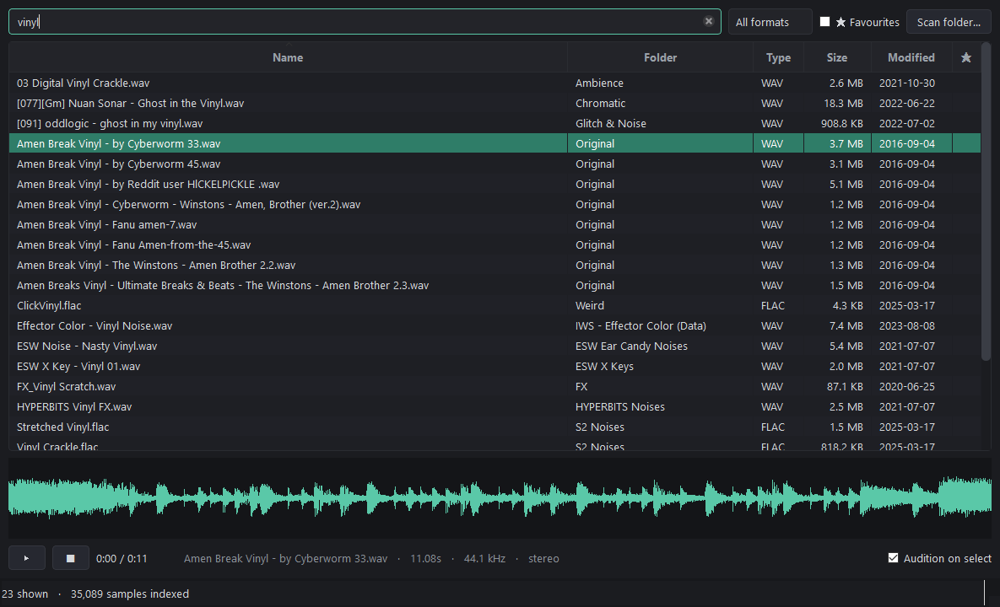

# Crate

A local-first sample library manager for music producers.

Producers accumulate tens of thousands of samples across packs, downloads and
drives, with filenames like `DRM_094.wav` and `Audio_338.wav`. A file browser
cannot answer *"find me a dark, aggressive, distorted kick."* Crate is being
built so that eventually it can.

Everything stays on your machine: local database, local files, local analysis.

**Status: Phase 2 — a working sample browser.** No audio analysis and no AI
yet. See [docs/roadmap.md](docs/roadmap.md).



## What works today

Point Crate at your sample folders, then browse and audition them.

```bash
crate scan "D:/Samples"
crate ui
```

- **Search** filenames *and folder names* — `dark kick` matches both.
- **Instant audition.** Click or arrow onto a sample and it plays immediately
  (median 11.5 ms to decode on a 35k library).
- **Waveform** with click-and-drag scrubbing.
- **Favourites**, which survive rescans and folder reorganisation.
- **Drag straight into your DAW.**
- **Filter** by format or favourites; **sort** by name, folder, size or date.
- **Scan from the window**, on a worker thread, with progress and cancel.

Formats: `.wav`, `.wave`, `.mp3`, `.flac`, `.aif`, `.aiff`, `.aifc`.

### Keyboard

| Key | Does |
| --- | --- |
| `↑` `↓` | Move through results, auditioning as you go |
| `Space` | Play / pause |
| `Esc` | Stop |
| `F` | Toggle favourite |
| `Ctrl+F` or `/` | Jump to the search box |
| `Ctrl+R` | Rescan every known folder |
| Double-click | Replay from the start |

## Setup

Requires Python 3.12+ (numpy 2.5 sets the floor). [`uv`](https://docs.astral.sh/uv/) is recommended but
optional.

```bash
git clone <your-remote> crate && cd crate
uv venv
uv pip install -e ".[dev]"
```

With plain pip:

```bash
python -m venv .venv && .venv/Scripts/activate   # source .venv/bin/activate on macOS/Linux
pip install -e ".[dev]"
```

Core dependencies are numpy, soundfile and sounddevice. The desktop window is
the `ui` extra (PySide6), so `crate scan` works on a headless box without a
GUI toolkit installed:

```bash
pip install -e .          # scanning and the CLI
pip install -e ".[ui]"    # plus the browser
```

## Usage

```bash
crate ui                     # open the browser
crate scan PATH [PATH ...]   # index directories (safe to re-run)
crate stats                  # summary of the indexed library
crate roots                  # directories Crate knows about
crate prune [--yes]          # forget records for files that are gone
crate --help
```

Useful flags:

| Flag | Purpose |
| --- | --- |
| `--data-dir DIR` | Use a different database/config location (handy for testing) |
| `--quiet` | No live progress line |
| `--show-errors N` | How many per-file failures to print after a scan |

### Where data lives

| Platform | Location |
| --- | --- |
| Windows | `%LOCALAPPDATA%\Crate\` |
| macOS / Linux | `~/.local/share/crate/` (or `$XDG_DATA_HOME/crate`) |

Override with the `CRATE_HOME` environment variable or `--data-dir`. The
directory holds `crate.db` and an optional `config.toml`:

```toml
audio_extensions = ["wav", "flac", "aiff", "mp3", "ogg"]
ignored_dir_names = ["Backups", "Bounces"]
follow_symlinks = false
scan_batch_size = 500
```

## Rescanning is cheap

Re-running a scan does **not** rebuild the database. Crate compares each file's
path, size and modification time against what it already knows and reports:

```
Scanned D:\Samples
  files found     41,208
  new             12
  changed         3
  unchanged       41,193
  moved           0
  now missing     0
  errors          1
```

Files that disappear are marked `missing`, never deleted — an unplugged
external drive must not wipe your library. Files under a directory that could
not be read are left alone entirely, because "unreadable" is not "deleted".
Use `crate prune --yes` when you actually want those records gone.

Renaming or moving a folder is recognised as a **move**, not as a deletion
plus an addition, so your favourites follow the files.

## Verifying it on a real library

Phase 1 is considered done only when it works on an actual sample library, not
just on fixtures. First run on this machine:

```
crate scan "D:/Music" "C:/Users/griff/Documents/Image-Line"
```

| | |
| --- | --- |
| Samples indexed | 35,089 |
| Total audio | 53.5 GB |
| Errors | 0 |
| Database size | 21 MB |
| Rescan of 34,461 files | 1.7 s (~21,000 files/s) |
| Rescan result | 0 new, 0 changed, 34,461 unchanged |
| Search, one keystroke | ~40 ms (debounced at 140 ms) |
| Audition (decode) | median 11.5 ms, p95 128 ms |
| Decode failures, 300 random samples | 0 |

The rescan number is the one that matters for indexing: re-running the scan
reuses every existing record instead of rebuilding the inventory. The decode
number is the one that matters for the browser — it is what makes arrowing
down a list of kicks feel like a sampler rather than a file manager.

Along the way this turned up 756 macOS AppleDouble sidecar files (`._Kick.wav`,
~200 bytes each) unpacked from Mac-authored sample packs. They are now skipped
at scan time.

## Development

```bash
pytest              # test suite
ruff check .        # lint
ruff format .       # format
mypy                # type check (strict)
```

## Documentation

- [docs/architecture.md](docs/architecture.md) — layers, boundaries, schema
- [docs/roadmap.md](docs/roadmap.md) — phases and their exit criteria
- [docs/decisions.md](docs/decisions.md) — design decisions and known debt

## Licence

MIT
